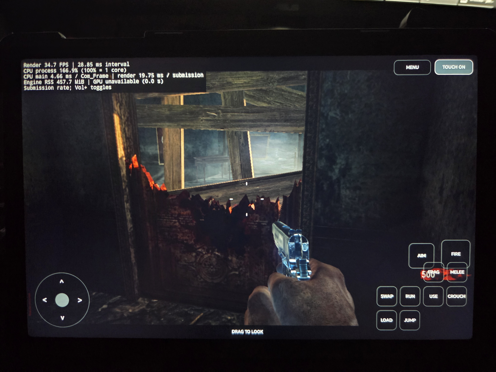
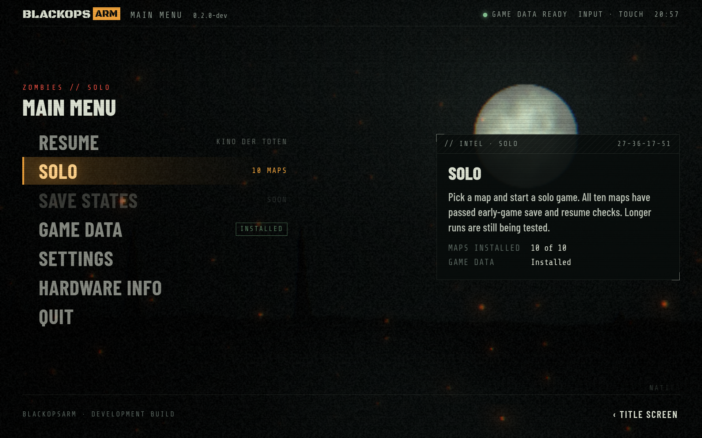
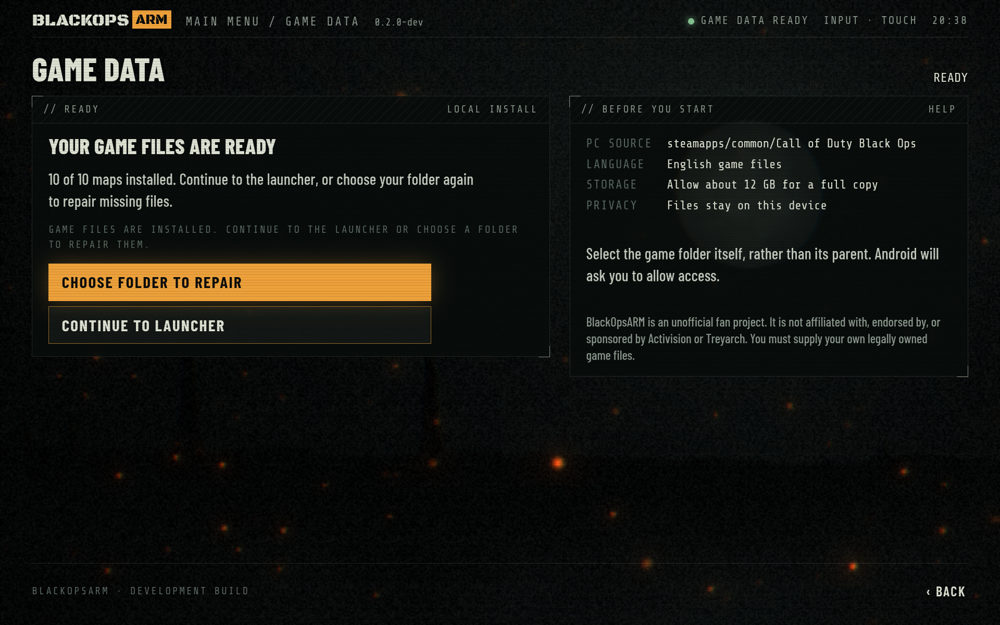
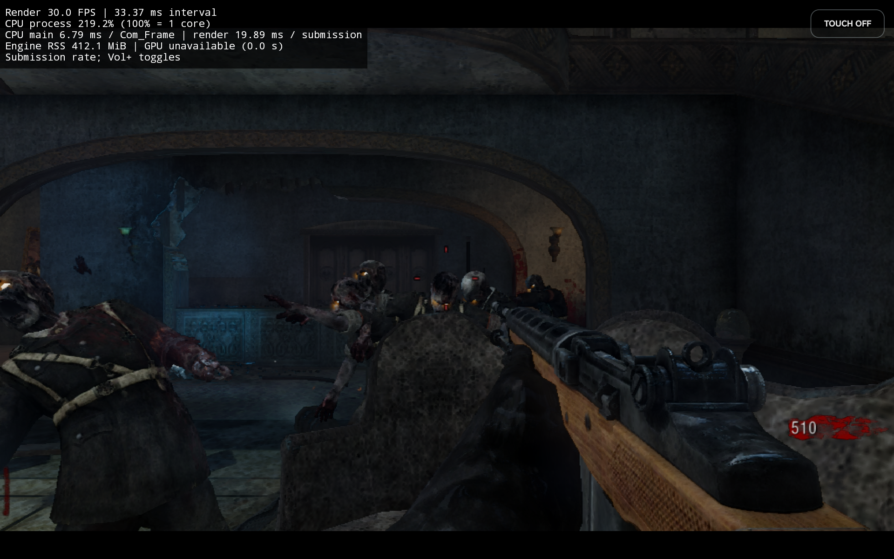
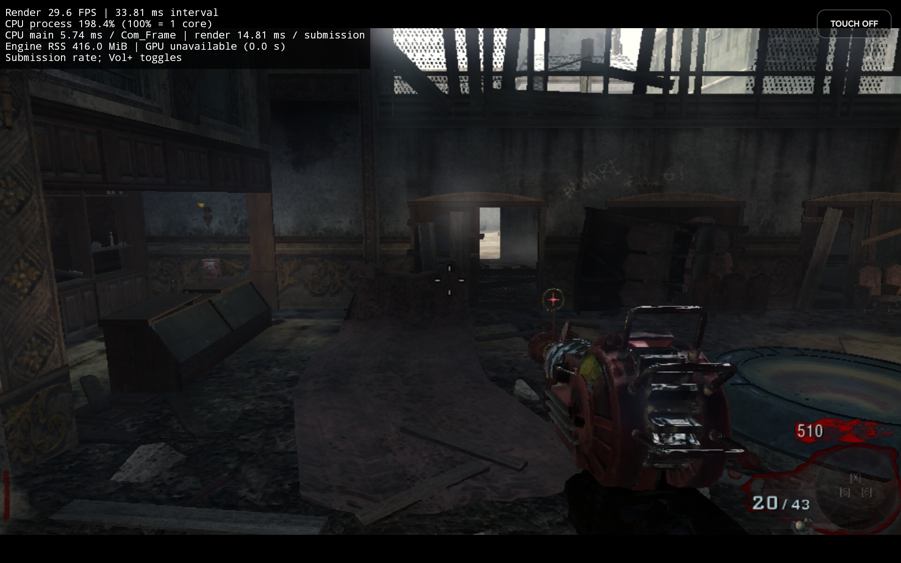
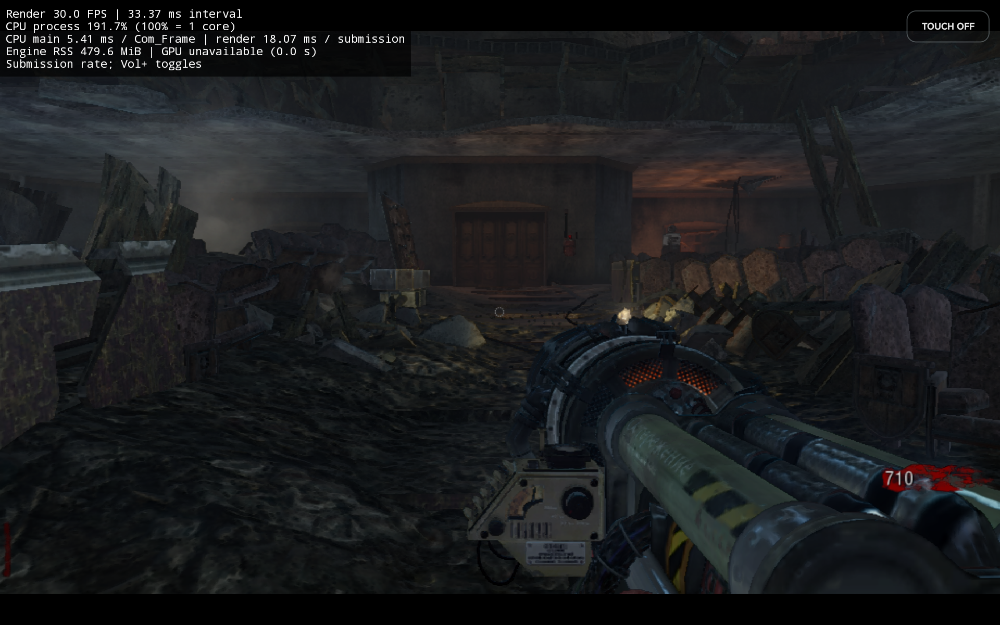
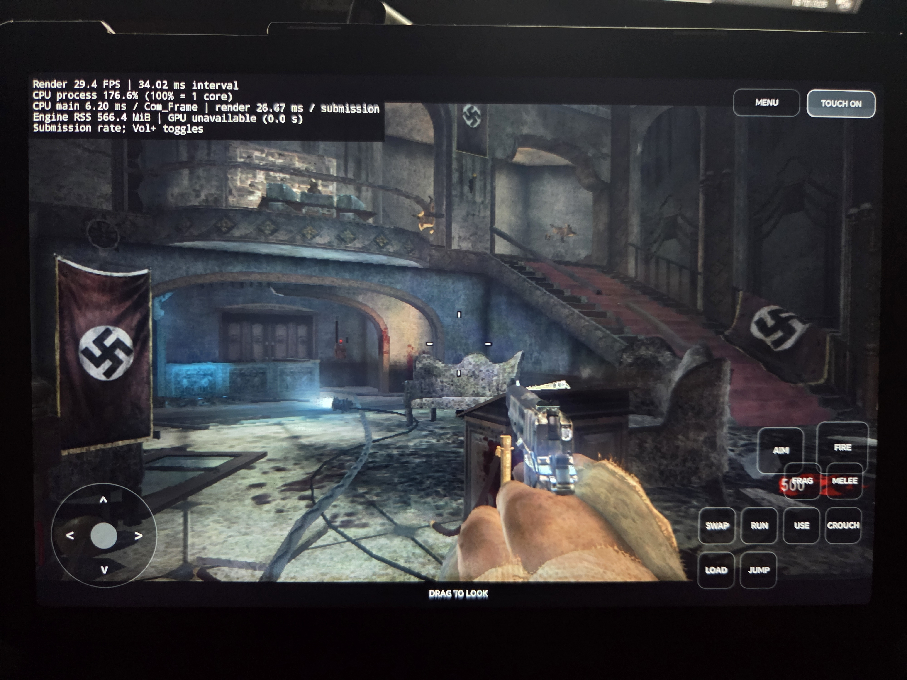
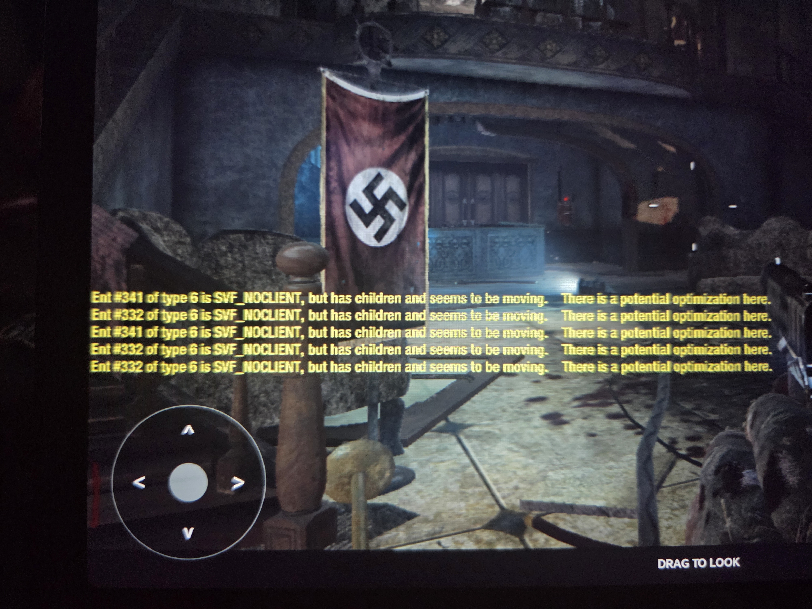

# Black Ops Zombies on Android ARM64 (native Vulkan)

Call of Duty: Black Ops (2010) Zombies running natively on an Android tablet:
the original engine, compiled for ARM64, rendering through a native Vulkan backend.

This is an unofficial research port. **No game data is included.** The engine
loads the original retail FastFiles, shaders and assets from a legally owned copy of
the game, which must be supplied separately.

**Version 0.2.0-dev · Android ARM64 · experimental development build**

This project is **not affiliated with, endorsed by, or sponsored by Activision
or Treyarch**. Call of Duty and Black Ops belong to their respective owners.

## Download and install

Get the APK from [Releases](https://github.com/ReeceKetley/BlackOpsARM/releases).
Install it on an ARM64 Android device with Vulkan support, then choose **Game
data** and select your original English PC game folder containing `main` and
`zone`. Copy the folder to your device first; allow about 12 GB for a full copy.
Android's folder picker grants access, and the installer copies/checks files in
app storage without modifying your originals. Existing completed files can be
reused after cancellation. No retail game files are supplied or downloaded.

Game assets are installed via the menu from your own legally obtained copy including DLC. Fonts and map artwork
are bundled; menu typography does not depend on an internet connection. Controller
settings include Classic / Linear / Dynamic response, right-stick deadzone and
ADS sensitivity this is still being worked on and as i am trying to port modern CoD gamepad "feel" . Hardware info is available from the main menu.

## Solo save and resume

Pause a solo Zombies game and choose **Save & leave**. The app writes a durable
save file and closes the game. Open BlackOpsARM again and choose **Resume** to
continue the saved run, including after fully closing the app.

The save system reconstructs gameplay through the engine's save/load system;
it does not restore a raw process-memory or Vulkan-memory snapshot. Important
state includes round/progression, player position and health, points, weapons
and ammunition, perks, opened doors, and the running Zombies script/world state.
Transient cosmetic effects or sounds may reset.

Rendered early-game save → full app close → fresh-process resume checks passed
on all ten launcher maps, with movement and firing afterward. Kino additionally
passed bought-door/perk and round-progression checks through repeated saves.
This remains experimental: longer runs and map-specific mechanics need more
coverage, and partial failed-load cleanup still needs hardening. Use explicit
**Save & leave**; backgrounding or Android killing the app does not create a save.
The multi-slot save library shown as “soon” is not implemented. Uninstalling the
app removes its imported files, settings and saves.

This is still very much expirmental and may not work super reliably.

## Future work

**Stabilty & Performance**: There's still a lot to do but it's playable some maps have issues such as call of the dead which im working on but the core maps and some DLC play fine on low spec hardware i have only tested this on my cheap android tablet the Honor Pad x8a which has 2GB of ram and a Snapdragon 680 and runs at a capped 30fps (There may be some dips while shaders compile briefly)
**Multiplayer & Mods**: While this is aimed at singleplayer "pick up and go" i possibly would add in multiplayer at some point.
**Better touch screen controls**: This project was mainly aimed at being used with a controller such as a bluetooth or wired xbox style controller however i would like to improve the touch screen experience a currently its very much setup for debugging. 

## Screenshots and gameplay

Captured directly on the HONOR Pad X8a on 1 November 2026, using 0.2.0-dev.
In-game shots show the actual performance overlay. Captures use developer weapon
grants, god mode and repositioning to show different parts of Kino; they are
showcase footage rather than an unassisted run or a sustained benchmark.

| Launcher | Game data installer |
| --- | --- |
|  |  |

| Kino lobby | Another view of Kino |
| --- | --- |
|  |  |

[Watch the launcher-to-gameplay recording](media/2026-11-01/menu-to-gameplay.mp4)
and [the combat clip](media/2026-11-01/kino-combat.mp4).
See the [capture notes and full gallery](media/2026-11-01/README.md) for setup,
recording limits and the complete media folder. Videos are screen recordings
without an audio track; loading/waiting edits are identified in the capture notes.

## How it got here

1. **32-bit decompilation.** The starting point is a decompilation of the
   original 32-bit x86 Windows Black Ops 1 engine (Zombies), based on
   [bo1-zombies-decompiled](https://github.com/MisaDev4/bo1-zombies-decompiled).
2. **x64 Windows.** The engine was ported from 32-bit to 64-bit Windows. That meant
   pointer widths, structure layouts, render command sizes, script handles,
   physics, savegames and a headless Zombies server, until gameplay matched the
   original.
3. **Vulkan through DXVK.** The Direct3D 9 renderer ran on Vulkan through
   [DXVK](https://github.com/doitsujin/dxvk) on Windows.
4. **Android ARM64 with DXVK.** The 64-bit engine was ported to Android ARM64
   (SDL2 + DXVK Native 1.9.2), with the original FastFiles and assets loaded
   unmodified.
5. **Native Vulkan.** The D3D9-through-DXVK layer was replaced by a native Vulkan
   backend written for the engine. The original D3D9 shader bytecode is translated
   to SPIR-V at load time, and the engine's render state, materials, textures and
   buffers map directly onto Vulkan.

## Device

| | |
|---|---|
| Device | HONOR Pad X8a (model NDL-L09) |
| SoC | Qualcomm Snapdragon 680 (SM6225, 6 nm) |
| CPU | 8 cores: 4x Cortex-A73 @ 2.4 GHz + 4x Cortex-A53 @ 1.9 GHz |
| GPU | Adreno 610, Vulkan 1.1 |
| RAM | 4 GB (≈3.7 GiB usable) |
| Display | 11" 1920x1200 |
| OS | Android 16, MagicOS 10.0 |

Current settings: 960x540 internal resolution upscaled with Snapdragon Game
Super Resolution (SGSR v1), 30 FPS cap, low/medium preset with medium textures,
model LOD scale 1.

## Performance

In the heaviest part of Kino der Toten the game now holds a steady 30 FPS (the cap) in
normal play. At the heaviest views the frame is GPU-bound at about 31 ms. Earlier
builds recorded 38 ms of CPU work per frame at the same spot and dropped to about
15 FPS when turning to new areas.

| Kino der Toten (spawn / lobby) | Earlier build |
|---|---|
|  |  |

(The photos are from 15-16 October 2026, before the parallel recording and
streaming fixes listed below.)

## Optimisations and porting work

### 64-bit and ARM64 correctness
- Native pointer widths throughout (`BO1_NATIVE_64BIT`) while keeping the
  original FastFile, asset, shader bytecode and fixed 32-bit disk/VM slots. Narrow32
  region handles hold pointers in 4-byte slots.
- Original x86 synchronisation (FastCriticalSection, interlocked counters) re-implemented
  with ARM64 atomics and explicit memory ordering, never assuming x86 ordering.
- The engine's own modified zlib ABI, the original StringTable hashing and
  normalisation, and bounded FastFile/zone readers with checked offsets.
- Real Android implementations of threads, memory, lifecycle, audio and input,
  in place of Win32 stubs.
- Fixed an out-of-bounds write in the physics profiling timer (`cdl_proftimer::reset`)
  that corrupted the impulse cache and asserted on grenade explosions.
- Fixed decompiled static model LOD distance scaling, which caused models to pop in.

### Native Vulkan backend
- D3D9 SM3 vertex and pixel shader bytecode translated to SPIR-V at load, with
  reflection-driven descriptor layouts. SPIR-V is freed after pipeline creation.
- Pipelines are cached: the driver pipeline cache is persisted, and pipeline "recipes"
  are saved and pre-built during map load to avoid mid-game compiles. The program cache
  holds 1024 programs.
- Engine render targets become Vulkan render passes, with lazy pass opening,
  load/store/clear decisions from tracked image contents, and resolves skipped
  when the result was not read.
- Per-draw state reuse: prepared programs, cached descriptor sets keyed by
  contents, reuse of identical constant uploads, merged index ranges, and
  copy-on-write snapshots for textures, constants and geometry.
- Native post processing: fused bloom/colour/depth-of-field passes, a
  dual-filter bloom chain, and the SGSR v1 upscaler at present.
- Small static vertex and index buffers packed into shared 16 MB allocations
  (7,713 buffers down to 147), keeping well under Adreno's 4,096 memory
  allocation limit.
- The static world index buffer is uploaded once, and BSP index runs that share
  lighting are merged (world draws per material list 1.84 → 1.25).
- Sun shadow caches (near partition and static brush models), so
  unchanged casters are not redrawn.

### Mobile CPU work
- **Parallel scene recording.** The main lit, post-resolve lit, decal and sun
  shadow draw lists are split at material boundaries. Worker threads pinned to
  the fast cores record the chunks into Vulkan secondary command buffers, using
  work-stealing so the threads finish together. The chunks run in the original
  order inside one render pass. Per-command-state binding registries are split
  into 32 independently locked shards, so threads don't queue on each other.
- **NEON skinning.** The SSE vertex skinning path is ported to ARM NEON:
  58-74 ns per vertex versus 167-188 ns for the scalar path.
- **Streaming stutter fixed.** Patching the static model cache made a copy-on-write
  copy of the whole cache buffer every frame (30-37 ms). It now writes in place
  under the original D3D `NOOVERWRITE` contract, which removed the 15 FPS dips
  when turning to new areas.
- Draw-time constant and texture snapshots, and frame storage that grows and shrinks
  with use.

### Memory
- Texture upload bytes released once copied to the GPU, and FastFile stream alias
  storage released after load.
- Static buffers packed, and per-frame draw storage pages trimmed after use.
- RSS + swap down from about 1.47 GB to about 1.06 GB in heavy play.

### Diagnostics
- Per-frame profiles (CPU record, GPU timestamps per pass, draw and pipeline
  statistics) and slow-frame loggers that show where a stalled frame's time went
  (game thread, frame hand-off, backend phases). A console FIFO changes dvars
  live on the device for A/B measurement.

## Repository layout

- `src/`: engine source (decompiled engine plus the Android/Vulkan port)
  - `src/gfx_vulkan/`: native Vulkan backend
  - `src/platform/android/`: Android platform services
- `android/`: Gradle/CMake Android project
- `tools/port/`: build, deploy, measurement and test tools
- `media/`: tablet screenshots, gameplay recordings and capture notes

Internal development notes and test evidence are retained locally and excluded
from the published repository.

## Credits

Based on [bo1-zombies-decompiled](https://github.com/MisaDev4/bo1-zombies-decompiled).
SGSR v1 is © Qualcomm (BSD-3-Clause, see `src/gfx_vulkan/native_post/THIRD_PARTY_NOTICES`).
Call of Duty: Black Ops is © Activision / Treyarch. This project is not affiliated with or endorsed by them.

## A note on AI assistance

This port was not written wholesale by AI agents. The porting work, architecture
and engineering decisions are human-led. AI agents were used as tools to help
with debugging and to build the new launcher.
